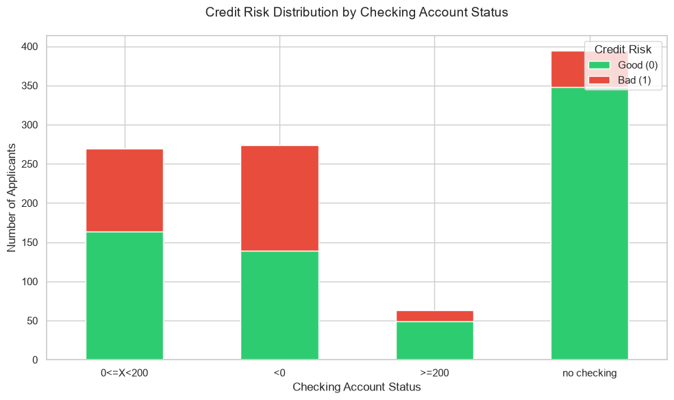
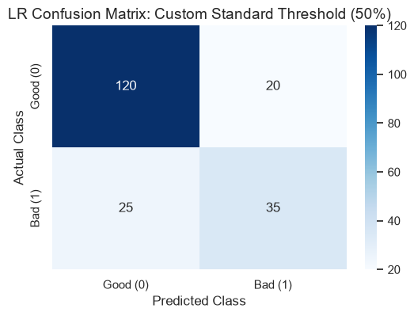
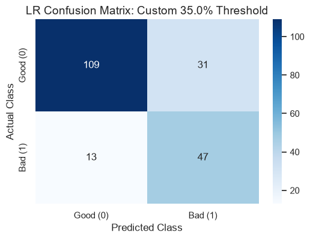

# German Credit Risk Classification

Binary classifier that predicts whether a loan applicant is a **good** or **bad** credit risk. It compares Logistic Regression, Linear SVM and k-Nearest Neighbors, built with leakage-free scikit-learn **Pipelines**, and tunes the decision threshold with cross-validation to catch more risky applicants.

Project 1 of *Machine Learning* (AI Engineering, TECNUN – University of Navarra, 2025-26).
**Author:** Aitor Marcalain Mauleón · **Full report:** [`docs/report.pdf`](docs/report.pdf)

## Problem

- **Dataset:** [German Credit / Statlog](https://www.openml.org/d/31) (OpenML id 31): 1,000 applicants with 20 mixed numerical and categorical features. It is downloaded automatically with `fetch_openml`.
- **Target:** `bad` = 1, `good` = 0. The classes are **imbalanced (70/30)**, so a model that always answers "good" already gets 70 % accuracy. That is why the models are tuned on **F1** and evaluated on **recall** for the "bad" class.
- **Business cost:** approving a bad applicant (a false negative) is far more expensive than rejecting a good one.

## Approach

1. **EDA:** class balance, histograms, boxplots by class (longer and larger loans are riskier) and categorical analysis (a negative checking account is the strongest warning sign).
2. **Preprocessing:** stratified 80/20 split, then a `ColumnTransformer` (`StandardScaler` for numerical features, `OneHotEncoder(handle_unknown='ignore')` for categorical ones) **inside a Pipeline**, so scaling and encoding are learned only on the training folds.
3. **Models:** Logistic Regression and Linear SVM (`C` tuned with `GridSearchCV`, 5-fold stratified CV, F1 scoring) and kNN (`k` tuned the same way).
4. **Threshold tuning without touching the test set:** with **out-of-fold predictions on the training set**, I pick the threshold with the highest recall whose accuracy is at most 3 points below the default threshold. The test set is used only once, for the final evaluation.

<p align="center">
  
</p>

## Results (held-out test set, 200 applicants)

| Model | Threshold | Accuracy | Precision | **Recall** | F1 |
|---|---|---|---|---|---|
| Logistic Regression (C = 10) | default 0.50 | 0.78 | 0.64 | 0.58 | 0.61 |
| **Logistic Regression (C = 10)** | **0.35** (CV) | **0.78** | 0.60 | **0.78** | **0.68** |
| Linear SVM (C = 1) | default 0.0 | 0.78 | 0.64 | 0.57 | 0.60 |
| Linear SVM (C = 1) | −0.25 (CV) | 0.77 | 0.59 | 0.80 | 0.68 |
| kNN (k = 5) | default | 0.72 | 0.57 | 0.35 | 0.43 |

With the tuned threshold, Logistic Regression raises recall from **0.58 to 0.78** at the same accuracy: **false negatives drop from 25 to 13**.

<p align="center">
  
  
</p>

**Recommendation: Logistic Regression with a 0.35 threshold.** It matches the Linear SVM on F1 but outputs **probabilities of default**, which a bank can use to set risk policies, explain decisions and move the cut-off as its risk appetite changes. kNN struggles with the class imbalance: risky applicants are usually surrounded by good ones, so it detects only 35 % of them.

The report also answers the discussion questions: why two linear models give different boundaries, the effect of `C` (under- and overfitting), and the bias–variance trade-off of `k` in kNN.

## Run it

```bash
git clone https://github.com/amarcalainm-oss/german-credit-risk-classification.git
cd german-credit-risk-classification
python -m venv .venv
.venv\Scripts\activate          # Windows  (Linux/macOS: source .venv/bin/activate)
pip install -r requirements.txt
jupyter notebook notebooks/german_credit_classification.ipynb
```

Tested with Python 3.14 and scikit-learn 1.9. The first run needs internet access to download the dataset from OpenML.

## Structure

```
├── notebooks/german_credit_classification.ipynb   # full analysis, executed with outputs
├── docs/report.pdf                                 # written report
├── assets/                                         # figures used in this README
└── requirements.txt
```

## Tech stack

Python · pandas · NumPy · scikit-learn · Matplotlib · Seaborn · Jupyter
